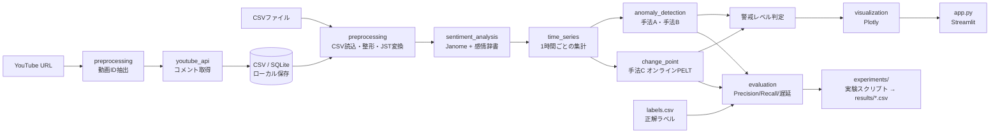

# STEP 1：システム設計書

**研究題目**：YouTubeコメントの時系列感情分析と異常検知を用いた炎上早期検知システムの開発と評価
**作成日**：2026-11-06（第1版）

---

## 0. 先に決めておくべき5つの設計判断（要約）

| # | 判断 | 理由 |
|---|---|---|
| 1 | **「炎上」を操作的に定義し、正解ラベルを評価前に固定する**（`labels.csv` のハッシュ値を Git にコミットして事前登録の証拠にする） | 結果を見てからラベルを動かすと評価が無効になる |
| 2 | **不祥事ニュース動画は「最初から否定的」なので、絶対値ではなく“その動画自身の過去との差”で判定する** | 話題が否定的であることと、コメント欄が炎上することは別の現象 |
| 3 | **全手法を「時刻 t までのデータだけで t を判定する」オンライン方式で実装する**（PELTも各時刻で再計算） | データリーク防止。全期間PELTの結果は「事後分析用」として別表示 |
| 4 | **感情辞書は「研究用（NRC日本語版・非公開）」と「公開デモ用（自作簡易辞書）」に分ける** | NRC辞書は研究利用は無料だが再配布禁止。公開リポジトリ・公開アプリには載せられない |
| 5 | **感情分析の精度を、手作業の正解付きコメント200件で測る** | 辞書ベースの誤判定が検知精度にどう効くかを論文で説明できるようにする |

---

## 1. この研究がデータ数理学科の卒論として成立する理由

単なる「アプリ開発」ではなく、次の数理的な問いを含むため、卒論として評価できる。

1. **時系列の統計的モデリング**：コメント到着を非一様ポアソン過程、否定的コメント数を二項分布として捉え、「比率は件数が少ないと分散 p(1−p)/n が大きく不安定になる」ことを根拠に最低コメント数条件を設計する。
2. **異常検知・統計的工程管理**：Zスコア法はシューハート管理図と同型。閾値と誤警報率・検知遅延のトレードオフ（ARL的な考え方）を実験で定量化する。
3. **変化点検出の最適化問題**：PELTは「ペナルティ付きコスト最小化による最適分割」を枝刈りで高速化する動的計画法（Killick et al., 2012）。ペナルティ値が変化点数を制御する仕組みを数式で説明できる。
4. **評価設計そのものが研究**：データリークの排除、正解ラベルの事前固定、調整用と評価用のデータ分離（事件単位のグループ分割）、少数標本での信頼区間・対応のある検定（McNemar検定）など、再現性のある評価方法を設計する。
5. **手法の比較実験**：3手法 × パラメータ × 感情情報の有無、という比較の軸が明確で、結果が「良かった/悪かった」どちらでも考察が書ける。

---

## 2. 3ヶ月で完成させるための最小機能（MVP）

### Must（これがないと卒論にならない）
- CSV読み込み → 感情分析 → 1時間ごとの時系列 → 3手法の検知 → グラフ表示（APIなしで動く）
- YouTube APIでのコメント取得とCSV保存（研究データ収集用）
- 3手法の**オンライン（リークなし）**実装と、正解ラベルを使った評価指標の計算
- 実験1・2・4を一括実行してCSVに保存する実験スクリプト
- テストコード、README

### Should（できれば）
- 実験3（パラメータ感度）のグリッド実行と結果グラフ
- Streamlit Community Cloudでの公開（架空データ＋自作辞書のデモ版）
- 感情辞書2種類（NRC / JIWC）の比較

### Won't（今回はやらない。「今後の課題」に書く）
- 機械学習（BERT等）による感情分析
- リアルタイム監視（定期自動取得）
- 未来予測

---

## 3. システム全体のアーキテクチャ

### モジュールの責任分担（データ処理・感情分析・検知・評価を分離）

| ファイル | 役割 | 入力 → 出力 |
|---|---|---|
| `src/config.py` | 全パラメータの一元管理 | — |
| `src/preprocessing.py` | URL解析、CSV読込・整形、保存 | URL/CSV → コメント表 |
| `src/youtube_api.py` | API取得・ページネーション・エラー処理 | 動画ID → コメント表 |
| `src/sentiment_analysis.py` | 形態素解析と辞書照合 | コメント表 → 感情スコア付きコメント表 |
| `src/time_series.py` | 時間ビン集計、移動平均、信頼性フラグ | コメント表 → 時系列表 |
| `src/anomaly_detection.py` | 手法A・B、警戒レベル | 時系列表 → 検知フラグ |
| `src/change_point.py` | 手法C（オンラインPELT） | 時系列表 → 検知フラグ |
| `src/evaluation.py` | 評価指標 | 検知フラグ＋ラベル → 指標 |
| `src/visualization.py` | Plotlyのグラフ | 各表 → 図 |
| `src/synthetic_data.py` | **架空データ**生成（動作確認専用） | seed → 架空コメント表 |
| `experiments/compare_methods.py` | 実験1〜4の一括実行 | データ＋ラベル → `results/*.csv` |

依頼の構成からの変更点：`src/config.py` と `src/synthetic_data.py` を追加し、データを `data/sample/`（架空・公開可）と `data/research/`（実データ・Git管理外）に分けた。

---

## 4. 使用する技術と選定理由

| 技術 | 用途 | 選定理由 |
|---|---|---|
| Python 3.11 | 全体 | 指定どおり。Streamlit Cloud でも選択可能 |
| Streamlit | Web画面 | Pythonだけで画面が作れ、無料で公開できる |
| pandas / NumPy | 集計 | 時系列の再サンプリング（`resample`）が簡単 |
| Janome | 形態素解析 | pure Pythonで `pip install` だけで動く（MeCabのような外部インストール不要）。Windows・Cloudで詰まりにくい |
| 感情辞書（後述） | 感情分析 | 出典・利用条件が確認でき、計算過程を説明できる |
| SciPy | 統計 | Zスコア、二項分布の信頼区間、検定 |
| ruptures | 変化点検出 | PELTの標準的な実装。論文（Truong et al., 2020）があり引用できる |
| Plotly | グラフ | 拡大・ホバー表示がそのまま使える |
| requests | API通信 | 公式クライアントより依存が少なく、エラー内容を直接扱える |
| CSV / SQLite | 保存 | CSV＝論文用の受け渡し、SQLite＝ローカルの取得キャッシュ（Cloudではファイルが消えるのでCSVを正とする） |
| GitHub / Streamlit Community Cloud | 管理・公開 | 無料。`secrets.toml` はGit管理外、Cloudでは Secrets 画面で設定 |

### 感情辞書の選定（要確認事項あり）

| 候補 | 内容 | 利用条件 | 本研究での扱い |
|---|---|---|---|
| **NRC Emotion Lexicon（日本語版）** | 英語の語–感情対応（anger, fear, anticipation, trust, surprise, sadness, joy, disgust ＋ positive/negative）をGoogle翻訳で多言語化したもの | 非商用の研究・教育目的は無料。**再配布禁止**、第三者に利用させることも不可。論文で引用必須 | **研究用（メイン）**。5感情がそのまま対応する。各自ダウンロードし `data/dictionaries/private/`（Git管理外）に置く。公開アプリでは使わない（使うなら作者にメールで許可を取る） |
| **JIWC辞書**（NAIST 荒牧研） | 日本語クラウドソーシングで作られた7感情（Sadness, Anxiety, Anger, Disgust, Trust, Surprise, Joy） | 公式ページにライセンス記載が見当たらない → **GitHubリポジトリで確認してから使う** | 比較用候補（Anxiety→fear と対応付け）。条件が確認できれば頑健性チェックに使う |
| **自作の研究用簡易辞書** | 炎上コメントに頻出する語を中心に数百語 | 自作なので公開可 | **公開デモ用**。収録語数・作成方法・限界を論文に明記 |

NRC日本語版の注意点：機械翻訳なので誤訳や英語の音訳が混じる。収録語数は、ダウンロードしたファイルから読み込み時に自動集計し、その数値を論文に記載する（推測の数値は書かない）。

---

## 5. データ収集方法と想定される問題点

### 収集方法
- `commentThreads.list`（1回で最大100件、**1ユニット**）でトップレベルコメントを取得し、`nextPageToken` でページ送り。
- 返信は `commentThreads` に一部しか含まれないため、返信数が多い親コメントについては `comments.list`（parentId指定、1ユニット）で追加取得。
- 動画情報（公開日時・総コメント数）は `videos.list`（1ユニット）で取得し、**取得率（取得件数/総コメント数）**を記録。
- 1日の割り当ては標準で **10,000ユニット**（太平洋時間0時にリセット）。2,000件の動画なら数十〜数百ユニットなので、1日に数十本は収集できる。
- **投稿者名・チャンネルIDは取得しない**（研究に不要な個人情報を持たない）。

### 想定される問題点と対策

| 問題 | 影響 | 対策 |
|---|---|---|
| **取得上限2,000件だと、大きな動画では新しいコメントしか取れない**（API は新しい順に返す） | 公開直後〜炎上初期が欠け、時系列が歪む | 研究データ収集時は上限を総コメント数以上に上げる。取得率を記録し、取得率が低い動画は対象外または制約として明記 |
| 削除・非表示コメントは取得できない | 当時の状態を完全には再現できない | 研究上の制約として明記（依頼文どおり） |
| 編集されたコメントは本文が編集後のもの | 投稿時の本文とずれる | `updatedAt≠publishedAt` の件数を記録し制約として明記 |
| コメント無効の動画、削除済み動画 | 取得エラー | エラー種別ごとに画面へメッセージを出し、処理は止めない |
| クォータ超過（403 quotaExceeded） | 途中で止まる | 途中までの結果を保存して、翌日に再開できるようにする |
| **不祥事ニュース動画は最初から否定的コメントが多い** | 「否定率の急増」が起きず、手法Aが反応しない／常に高い | ①動画自身の過去との差で判定 ②対象選定時に「投稿後にきっかけ（続報・謝罪会見など）が起きた動画」を炎上事例に含める ③「否定的だが炎上でない」動画を非炎上群に入れて誤警報を測る |
| 炎上開始時刻があいまい | 検知遅延が定義できない | 下記のラベル付け手順で操作的に定義する |
| 公開アプリからの個人情報漏洩 | 倫理問題 | 公開版には実データを置かない。結果は集計値で公開し、論文でのコメント引用は言い換える |
| 保存データの扱い | YouTube API の利用規約 | **YouTube API Services の開発者ポリシーにある「データの保存期間」の規定を確認**し、指導教員とも相談する |

### 正解ラベルの付け方（事前に固定する）
`data/research/labels.csv`（Git管理外）に記録し、その **SHA-256ハッシュ値を `docs/labels_sha256.txt` としてコミット**して事前登録とする（後から内容を変えるとハッシュが一致しなくなる）。

| 列 | 意味 |
|---|---|
| `video_id` | 動画ID |
| `incident_id` | 事件ID（同じ事件の動画は同じID → データ分割に使う） |
| `is_fire` | 炎上=1 / 非炎上=0 |
| `fire_start_jst` | 炎上開始時刻（非炎上は空欄） |
| `label_source` | 判断根拠（例：報道記事URL・時刻） |
| `split` | `dev`（閾値調整用）/ `test`（最終評価用） |

- **炎上開始時刻の定義（案）**：炎上のきっかけとなった出来事が、外部の報道・公式発表で最初に確認できた時刻（コメント自体からは決めない → 検知結果との循環を防ぐ）。
- 外部時刻が取れない場合は「炎上開始時刻不明」として**検知遅延の評価から除外**し、その件数を報告する。
- 可能なら友人など第2の判定者が独立に `is_fire` を付け、一致度（Cohenのκ）を報告する。
- 規模の目安：炎上 15〜20本、非炎上 15〜20本（うち「話題は否定的だが炎上していない」ニュース動画を半数程度）。

---

## 6. 異常検知アルゴリズムの具体的な設計

### 記号
- 時間ビン t（初期値1時間）。n_t：コメント数、n_t^neg：否定的コメント数
- 基準期間 B_t = {t−24, …, t−1}（**t 自身を含まない**過去24ビン）
- すべての判定は時刻 t の時点で観測済みのデータだけを使う

### 感情スコアと否定判定（STEP 3で実装）
1. Janomeで分かち書きし、名詞・動詞・形容詞・副詞の**基本形**を辞書と照合
2. 感情語の直後2語以内に否定の助動詞・形容詞「ない／ぬ／ん」があれば、その語は**数えない**（「最悪ではない」対策。反転はしない）
3. M = 何らかの感情に一致した語の数、m_e = 感情 e に一致した語の数
   score_e = m_e / M（0〜1）。**M = 0 のときは NaN（判定不能）**
4. 否定的コメント：M > 0 かつ (anger・fear・sadness のいずれかに一致した語の数)/M ≥ θ（初期値0.5）
   → 判定は「否定的 / 非否定的 / 判定不能」の3値。**判定不能を肯定的とはみなさない**
5. 辞書のカバー率（判定可能なコメントの割合）を時間ごとに記録する
6. 限界：皮肉（「さすがですね（笑）」）、文脈依存、ネットスラング、機械翻訳辞書の誤訳 → 正解付き200件で精度を実測

### 時系列（STEP 3〜4）
- コメントのない時間も0件のビンとして含める
- n_t = 0 のビンでは否定的コメント率 N_t を **NaN**（0%にしない）
- n_t < 10 のビンは「信頼性低」フラグを付けてグラフ上で薄く表示

### 手法A：否定的コメント率
- N_t = n_t^neg / n_t
- 基準値（初期値は件数で重み付けした比率。単純平均も選択可）
  N̄_t = Σ_{s∈B_t} n_s^neg / Σ_{s∈B_t} n_s
- **検知条件**：n_t ≥ n_min（10）かつ Σ_{s∈B_t} n_s ≥ n_min かつ N_t − N̄_t ≥ δ（0.15）
- 理由：単純平均だと件数1〜2のビンの極端な比率に引っ張られるため、件数で重み付けする

### 手法B：Zスコア
- μ_t, σ_t ＝ B_t の n_s の平均と標本標準偏差
- Z_t = (n_t − μ_t) / max(σ_t, σ_floor)（σ_floor=1。**σ=0 によるゼロ除算を回避**）
- **検知条件**：Z_t > 3、かつ B_t のうち有効なビンが12以上（公開直後24時間は基準期間が足りないので判定しない＝ウォームアップ）
- 公開直後の自然な増加への配慮：コメント数は公開直後に多く、その後減衰する。オプションとして log(1+n_t) 変換を用意し、実験3で比較する。この区別の難しさは手法Bの限界として考察する

### 手法C：変化点検出（オンラインPELT）
各時刻 t で次を行う（**時刻 t までのデータだけ使う**）。
1. 直近 L=72 ビンの N_s を取り出す。NaN は**直前の観測値で埋める**（過去方向のみ、未来は使わない）
2. `ruptures.Pelt(model="rbf").fit(y).predict(pen=penalty)` で変化点を求める
3. 変化点 τ が直近 k=3 ビン以内にあり、かつ変化後の平均 > 変化前の平均（上昇方向）なら、**時刻 t に検知**
4. 同じ変化点（絶対時刻）は1回だけ検知として数える
- 検知時刻は「変化点の位置 τ」ではなく「**それを検出できた時刻 t**」。これを検知遅延の計算に使う
- 全期間で1回だけ計算した変化点は、グラフ5に「事後分析用（評価には不使用）」として別表示する
- 計算量：PELTは条件付きで O(n)、最悪 O(n²)。rbf は n×n のカーネル行列を作るため、窓 L を制限する。遅い場合は `model="l2"` に切り替え（設定で変更可）

### STEP 4 実装時に決めたこと・変更したこと（2026-11-07）
| 項目 | 設計時 | 実装 | 理由 |
|---|---|---|---|
| 手法Cの入力 | 件数不足のビンは直前値で埋める | **件数不足のビンは除外**し、信頼できるビンだけを時刻順に並べる | 件数不足が長く続くと同じ値が並ぶ人工的な平坦区間ができ、架空データでPELTの結果がゆがんだ |
| PELTのペナルティ | 10 | **3**（仮置き） | rbfでは区間のコストが区間長以下のため、10では架空の炎上を検知できなかった。本番の値は dev データで決める（実験3） |
| 手法Cの検知条件 | 上昇方向 | 変化前後の平均の差が **+15ポイント以上**（仮置き） | 手法Aと同じ大きさにそろえ、ごく小さな水準変化を除く |
| 手法Cの履歴条件 | （未定） | 手法Aと同じく最初の24時間は判定しない | 比較の公平さのため |
| 手法Bの最低コメント数 | （未定） | **10件**（仮置き） | 0〜1件が続いたあとの数件でZが極端になる誤警報を防ぐ |
| 手法Bの履歴条件 | 有効ビン12以上 | 直前24ビンがそろってから判定 | コメント数は0件でも有効な値なので「24時間分の履歴」で統一 |
| 手法Aの二項検定 | なし | **オプション（初期値オフ）**：p値 ≤ 0.01 を追加条件にできる | 架空データで、件数10〜20件の時間帯の偶然の上振れによる誤警報が多かったため比較用に追加 |
| 架空データ | 2日目以降 約3件/時 | 約15件/時、否定的ニュース動画に続報による投稿増を追加 | 約3件ではほぼ全時間帯が件数不足になり、手法の比較ができなかった |

### 警戒レベル
- **赤（警戒）**：同じ集計時間帯に2手法以上が検知（必要な手法数は変更可）。
- **黄（注意）**：警戒の条件を満たさず、現在を含む直近3時間に検知がある。**緑（正常）**：その間に検知がない。
- 別々の時間帯の検知を組み合わせると通常の架空動画で誤警戒が出たため、警戒には同じ時間帯での一致を求める。実データでの性能は調整用・評価用データを分けて検証する。
- 画面には「研究上の暫定基準であり、炎上を保証しない」と常に表示

### 評価指標（正解ラベルがある場合のみ計算）
- 連続する検知は6時間以内なら1回の検知イベントにまとめる
- 炎上動画：[開始, 開始+48時間] に検知があれば正検知（TP）、なければ見逃し（FN）。**開始前の警報は正解として数えず、誤警戒として数える**（STEP 6 で「開始−2時間」から変更）
- 検知の遅れは、手法Cも含めて**実際に検知できた時刻**で計算する（推定された変化点の位置は使わない）
- 全期間を使った事後分析の変化点は参考表として別に出し、指標には入れない
- 非炎上動画：検知が1回でもあれば誤検知（FP）、なければ TN
- **Precision, Recall, F1**（動画単位）
- **誤警報率**：①非炎上動画のうち誤検知が出た割合 ②監視100時間あたりの誤検知イベント数
- **検知遅延**：最初の正検知時刻 − 炎上開始時刻（中央値と四分位範囲）
- 標本が少ないため、比率には **Wilsonの95%信頼区間**、F1には動画単位のブートストラップ区間を付ける
- 実験4（感情なし vs あり）は同じ動画で比較するので **McNemar検定**（正確検定）

- 監視時間（100時間あたり誤警戒の分母）＝非炎上動画の全期間＋炎上動画の開始前の期間

### 評価の手順（STEP 6 で実装。`experiments/compare_methods.py`）
1. `split`：事件（incident_id）単位で dev（調整用）／test（評価用）に分ける。炎上を含む事件と含まない事件それぞれで40%（切り上げ）を dev
2. `freeze-labels`：正解ラベルCSVの SHA-256 を `experiments/protocol/` に記録。以後ラベルを変えると tune・test が止まる
3. `tune`：**dev の動画だけ**でパラメータを総当たり（集計幅・δ・二項検定の有無・Z閾値・PELTペナルティ）。事前に決めた規則（検知器「警戒」の dev F1 最大 → 100時間あたり誤警戒が少ない → 遅れ中央値が小さい → 番号が小さい）で1つ選んで固定
4. `test`：固定した設定と同じ辞書で、test の動画を**1回だけ**評価。2回目や test 後の再調整は理由の記録なしには実行できない（`protocol_log.csv` に残る）
- アプリの「アルゴリズム比較」画面は split=test の動画を評価しない（閾値を見ながら test を覗かないため）

### 実験4の組み合わせ方法
- A：手法Bのみ（コメント数）
- B-AND：手法B かつ 否定率上昇（δ'）→ 誤警報が減るかを検証
- B-OR：手法B または 手法A → 見逃しが減るかを検証
- 実装では同じ集計時間帯での組み合わせ（検知器「B∧A」「B∨A」）とし、McNemar 正確検定で手法Bと比べる

---

## 7. 12週間の開発スケジュール

開始 2026-11-09（月）、終了 2027-01-31（日）。提出日が分かったら逆算して調整する。

| 週 | 期間 | 作業 | 完了条件 |
|---|---|---|---|
| 1 | 11/9–11/15 | **STEP 1** 設計・環境構築・Git初期化。APIキー取得。指導教員と「炎上の定義」「ラベル手順」を合意 | `pytest` が通る、アプリが起動する |
| 2 | 11/16–11/22 | **STEP 2** コメント取得・CSV/SQLite保存。対象動画の候補リスト作成 | 実動画でCSVが保存できる |
| 3 | 11/23–11/29 | 対象動画の選定・**ラベル確定とコミット（事前登録）**・データ収集開始・dev/test 分割 | `labels.csv` 確定 |
| 4 | 11/30–12/6 | **STEP 3** 感情分析・時系列集計。正解付き200件の作成 | 感情分析の精度が出る |
| 5 | 12/7–12/13 | **STEP 4** 手法A・B・警戒レベル | テストが通る |
| 6 | 12/14–12/20 | 手法C（オンラインPELT）、評価指標 | リークがないことのテストが通る |
| 7 | 12/21–12/27 | **STEP 5** ダッシュボード・比較画面・データ確認画面 | 全画面が動く |
| 8 | 12/28–1/3 | 予備週（年末年始）。不具合修正・データ収集の補完 | — |
| 9 | 1/4–1/10 | **STEP 6** devで閾値調整 → testで実験1・2・4を**1回だけ**実行 | `results/*.csv` |
| 10 | 1/11–1/17 | 実験3（パラメータ）、図表作成。**STEP 7** Cloud公開 | 公開URL |
| 11 | 1/18–1/24 | **STEP 8** 論文執筆（方法・結果を先に書く） | 初稿 |
| 12 | 1/25–1/31 | 考察・結論・推敲、発表資料 | 提出版 |

**最大のリスクはデータ収集とラベル付け**（第2〜4週）。ここが遅れたら Should の機能（実験3、Cloud公開、辞書比較）から削る。

---

## 8. 最初に作成したファイル（STEP 1 の実装）

| ファイル | 状態 | 内容 |
|---|---|---|
| `src/config.py` | ✅ 実装済み | 全パラメータの初期値、列定義 |
| `src/preprocessing.py` | ✅ 実装済み | URL→動画ID（通常・短縮・Shorts・embed・live・IDのみ）、CSV読込（UTF-8/cp932自動判別、JST変換、重複・不正行の除外と警告）、CSV保存（Excelで文字化けしないBOM付きUTF-8） |
| `src/synthetic_data.py` | ✅ 実装済み | 架空データ3本（炎上・通常・最初から否定的）＋正解ラベル。seed固定で再現可能 |
| `data/sample/sample_comments.csv`, `sample_labels.csv` | ✅ 生成済み | すべて `data_source=synthetic`、本文に【架空】を付与 |
| `app.py` | ✅ STEP 1版 | ホーム画面（URL確認、CSV読込、架空データ読込、概要表示、CSVダウンロード）。他の画面は「未実装」と表示 |
| `tests/test_preprocessing.py` | ✅ 26件合格 | URL解析、文字コード、タイムゾーン、不正行、往復保存、架空データの再現性 |
| `requirements.txt` ほか設定ファイル | ✅ | `.gitignore` で秘密情報・実データ・NRC辞書を除外 |
| `youtube_api.py` 以降 | ⏳ 未実装 | STEP 2 以降で作成 |

### この設計で指導教員に確認したいこと
1. 「炎上」の定義と炎上開始時刻の決め方（外部の報道時刻を使う案でよいか）
2. YouTubeコメントの研究利用に関する学内の倫理手続きの要否
3. NRC辞書（機械翻訳）を使うことの妥当性と、JIWC辞書との比較を入れるか
4. 対象動画の本数（炎上・非炎上 各15〜20本）で十分か

---

## 参考文献（STEP 1 時点。論文には原典を確認してから記載する）
- Killick, R., Fearnhead, P., & Eckley, I. A. (2012). Optimal detection of changepoints with a linear computational cost. *Journal of the American Statistical Association*, 107(500).
- Truong, C., Oudre, L., & Vayatis, N. (2020). Selective review of offline change point detection methods. *Signal Processing*, 167.（ruptures）
- Mohammad, S. M., & Turney, P. D. (2013). Crowdsourcing a word–emotion association lexicon. *Computational Intelligence*, 29(3).（NRC Emotion Lexicon）
- 柴田大作, 若宮翔子, 伊藤薫, 荒牧英治 (2017). JIWC: クラウドソーシングによる日本語感情表現辞書の構築. 言語処理学会第23回年次大会 B5-3.
- YouTube Data API v3 公式ドキュメント「Quota costs」https://developers.google.com/youtube/v3/determine_quota_cost
- NRC Emotion Lexicon 公式ページ https://saifmohammad.com/WebPages/NRC-Emotion-Lexicon.htm
- JIWC-Dictionary 公式ページ https://sociocom.naist.jp/jiwc-dictionary-en/
